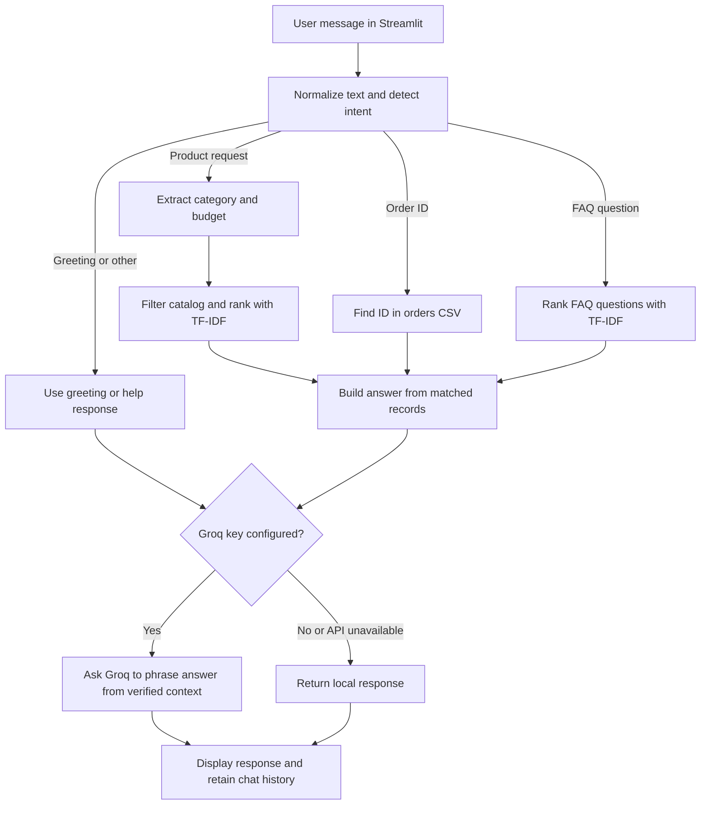

# AI E-Commerce Assistant

A Streamlit chatbot demonstrating product recommendations, order lookups, and FAQ support. The project combines Python rule-based intent detection, local structured data, TF-IDF text similarity, and an optional Groq API integration.

> **Demo-data notice:** This repository is an educational prototype, not a live store. The 10,000-row catalog is mostly synthetic, and the sample orders and policies are not connected to a retailer. Do not use its prices, delivery information, or availability for real purchases.

## Features

- Recommend products using category, budget, and text relevance.
- Look up example order status by order ID.
- Retrieve answers from a small local FAQ collection.
- Keep chat history in the Streamlit session and use recent turns for optional LLM phrasing.
- Run without an API key using deterministic local responses.
- Rebuild the demo product catalog reproducibly.

## How the project was built

The application is a small Python pipeline rather than a separately trained model. Streamlit collects each message, the inference module selects a request type, and a focused handler reads the relevant local data. TF-IDF and cosine similarity rank product descriptions and FAQ questions. When configured, Groq receives the user question and verified local context to phrase a response; it does not train or fine-tune a model.

### Request workflow



### Recommendation and support logic

1. `inference.py` normalizes the text and checks for greetings, unsupported clothing categories, order IDs, product requests, and FAQ topics.
2. For product requests, `product_recommender.py` extracts a supported category and, when present, a budget. It filters the CSV before ranking, so recommendations stay within an explicit category and budget.
3. It combines each remaining product's name, category, and description, then uses scikit-learn's `TfidfVectorizer` and cosine similarity to rank relevance. The assistant returns up to three matches.
4. For an order ID, `order_tracker.py` performs an exact, case-insensitive lookup in the local orders CSV.
5. For an FAQ, `faq.py` compares the message against stored FAQ questions and returns the closest answer when its similarity passes a threshold.
6. If `GROQ_API_KEY` is available, the inference layer sends the question, recent conversation turns, and the locally verified answer context to Groq. The prompt instructs the model not to invent catalog, order, or policy facts. If the key is absent or the call fails, the local answer is returned.

## Dataset provenance

`data/products.csv` contains exactly 10,000 rows:

- **20 sample records** were present in the project's original local product file. This repository does not document an external dataset or retailer source for those records, so they should be treated as example data, not attributed to a third party.
- **9,980 synthetic records** are generated by `generate_products.py`. The script uses a fixed random seed (`20261014`), cycles through the supported categories, and combines example brand/series names, descriptions, and category-specific price ranges. These are generated listings, not verified products or real offers.
- The `source` column distinguishes `sample` rows from `synthetic_demo` rows. Products generated by the script use IDs beginning with `G` and names beginning with `Demo`.

The generator uses Python's standard library; it does not download or scrape product data. Re-running `python generate_products.py` preserves non-generated rows and recreates the synthetic rows deterministically. Replace this file with a licensed, retailer-provided catalog before adapting the application for real commerce. The app currently has no inventory, stock, or price synchronization.

The example orders in `data/orders.csv` and FAQ answers in `data/faqs.json` are also local project demo data. They are not sourced from a real store or live support system.

## Data files

| File | Purpose | Main fields |
| --- | --- | --- |
| `data/products.csv` | Product recommendation catalog | `id`, `name`, `category`, `price`, `description`, `source` |
| `data/orders.csv` | Example order lookup records | `order_id`, `customer`, `product`, `status`, `expected_delivery` |
| `data/faqs.json` | Example question-and-answer knowledge base | `question`, `answer` |

## Project structure

| Path | Responsibility |
| --- | --- |
| `app.py` | Streamlit page, chat history, and message form |
| `inference.py` | Intent routing, response construction, optional Groq integration |
| `product_recommender.py` | Product filtering and TF-IDF ranking |
| `order_tracker.py` | Order ID lookup |
| `faq.py` | FAQ similarity search |
| `generate_products.py` | Deterministic generation of the 10,000-row demo catalog |
| `data/` | Local product, order, and FAQ data |
| `requirements.txt` | Python package dependencies |
| `.env.example` | Example name for the optional Groq API key setting |

## Setup and run

Use Python 3.10 or newer. From the project directory, create and activate a virtual environment, then install dependencies:

```bash
python -m venv .venv
```

Windows PowerShell:

```powershell
.\.venv\Scripts\Activate.ps1
```

macOS/Linux:

```bash
source .venv/bin/activate
```

Install and start the app:

```bash
python -m pip install -r requirements.txt
streamlit run app.py
```

Open the local URL printed by Streamlit, usually `http://localhost:8501`.

### Optional Groq integration

The app works without a key. To enable Groq phrasing, create a `.env` file in the project root based on `.env.example`, then set your own key:

```env
GROQ_API_KEY=your_api_key_here
```

Keep `.env` private and never commit an API key. Requests sent to Groq include the user's message, recent chat turns, and the relevant local answer context. Review the provider's terms and privacy practices before using real customer data.

### Rebuild the demo catalog

```bash
python generate_products.py
```

The generator rewrites `data/products.csv` to contain the original non-generated sample records plus 9,980 reproducible synthetic listings.

## Example questions

- `Recommend a laptop under 60000 for programming`
- `What mobiles do you have?`
- `I need a laptop under 10000`
- `Where is my order ORD1001?`
- `What is your return policy?`

## Limitations and next steps

- The assistant is not a fine-tuned or trained ChatGPT model. The product and FAQ similarity models are fit locally at query time; Groq is an optional response-generation API.
- Synthetic rows increase catalog size for demonstrations, not factual coverage or recommendation quality. Similarity scores do not verify a product's real-world quality.
- The sample order and FAQ files are small, static examples. There is no authentication, order-management integration, inventory feed, or live price checking.
- Intent detection and FAQ matching use lightweight rules and similarity thresholds; ambiguous or unsupported questions can be routed incorrectly.
- The repository does not currently include an automated test suite or measured recommendation benchmark.
